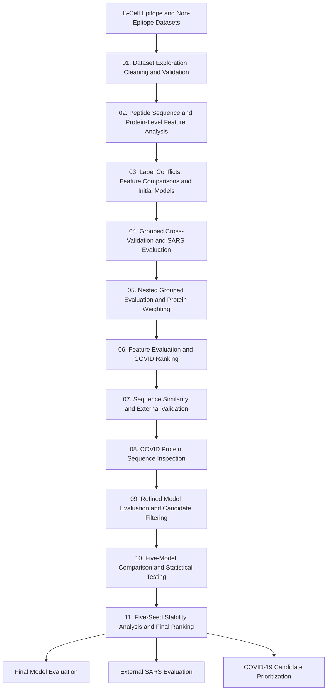

<p align="center">
  
</p>

<h1>B-Cell Epitope Classification and Machine-Learning-Based Peptide Prioritization</h1>

<h3>A Python-Based Machine Learning Pipeline for Peptide Classification, Model Evaluation, and Candidate Ranking</h3>

<p align="center">
  
  
  
  
  
  
  
  
</p>

---

<p>
  <i>A computational machine-learning workflow for B-cell epitope classification and COVID-19 peptide prioritization. The project integrates peptide dataset validation, physicochemical feature analysis, protein-grouped model evaluation, statistical testing, external SARS evaluation, and ensemble-based candidate ranking.</i>
</p>

---

<h2>📑 Table of Contents</h2>

<ul>
  <li><a href="#project-overview">Project Overview</a></li>
  <li><a href="#research-question">Research Question</a></li>
  <li><a href="#datasets">Datasets</a></li>
  <li><a href="#objectives">Objectives</a></li>
  <li><a href="#repository-structure">Repository Structure</a></li>
  <li><a href="#installation">Installation</a></li>
  <li><a href="#requirements">Tools and Requirements</a></li>
  <li><a href="#project-workflow">Project Workflow</a></li>
  <li><a href="#pipeline-steps">Pipeline Steps</a></li>
  <li><a href="#data-validation">Data Validation and Feature Analysis</a></li>
  <li><a href="#machine-learning">Machine-Learning Models</a></li>
  <li><a href="#model-evaluation">Model Evaluation and Statistical Analysis</a></li>
  <li><a href="#sars-evaluation">SARS External Evaluation</a></li>
  <li><a href="#covid-analysis">COVID-19 Sequence Analysis and Candidate Ranking</a></li>
  <li><a href="#limitations">Limitations</a></li>
  <li><a href="#conclusion">Conclusion</a></li>
  <li><a href="#future-work">Future Work</a></li>
  <li><a href="#references">References</a></li>
  <li><a href="#license">License</a></li>
  <li><a href="#author-contact">Author and Contact</a></li>
</ul>

---

<h2 id="project-overview">📖 Project Overview</h2>

<p>This project develops a computational workflow to classify B-cell epitope and non-epitope peptides using sequence-derived physicochemical features.</p>

<p>The analysis integrates dataset validation, exploratory data analysis, feature evaluation, protein-grouped machine learning, statistical testing, external SARS evaluation, and COVID-19 peptide prioritization.</p>

<p>Eleven Python scripts progressively develop and evaluate the workflow. The final analysis compares five machine-learning classifiers, examines model stability across five random seeds, and applies an ensemble approach to rank candidate peptides derived from an unlabeled COVID-19 protein sequence.</p>

> <p><b>Project focus:</b> To evaluate how effectively sequence-derived physicochemical features support B-cell epitope classification and how the resulting models perform during independent SARS evaluation and COVID-19 peptide candidate prioritization.</p>

---

<h2 id="research-question">🔬 Research Question</h2>

<p><b>How effectively can machine-learning models using sequence-derived physicochemical features distinguish B-cell epitope peptides from non-epitope peptides, and how reliably do these models generalize to independent SARS data and prioritize candidate peptides from an unlabeled COVID-19 protein sequence?</b></p>

<p>This research question guided the dataset validation, feature analysis, model development, statistical evaluation, external testing, and candidate-ranking stages.</p>

---

<h2 id="datasets">📂 Datasets</h2>

<p>The project uses three peptide datasets: B_Cells, SARS, and COVID.</p>

<table>
  <tr>
    <th>Dataset</th>
    <th>Records</th>
    <th>Description</th>
  </tr>
  <tr>
    <td>B_Cells</td>
    <td>14,372</td>
    <td>Labeled epitope and non-epitope peptides after final cleaning</td>
  </tr>
  <tr>
    <td>SARS</td>
    <td>514</td>
    <td>Labeled SARS peptide records</td>
  </tr>
  <tr>
    <td>COVID</td>
    <td>20,312</td>
    <td>Unlabeled peptide records derived from one protein sequence</td>
  </tr>
</table>

<h3>Dataset Cleaning</h3>

<p>The original B_Cells dataset contained 14,387 records. Initial cleaning removed five exact duplicate rows. Further validation removed nine conflicting-label rows and one duplicate-coordinate row, resulting in 14,372 records.</p>

<p>The original SARS dataset contained 520 records. Six exact duplicate rows were removed, leaving 514 records.</p>

<h3>Class Distribution</h3>

<table>
  <tr>
    <th>Dataset</th>
    <th>Negative</th>
    <th>Positive</th>
  </tr>
  <tr>
    <td>B_Cells</td>
    <td>10,484</td>
    <td>3,898</td>
  </tr>
  <tr>
    <td>SARS</td>
    <td>380</td>
    <td>134</td>
  </tr>
</table>

<p>The labeled datasets have similar class distributions. The COVID dataset contains no target labels and was reserved for candidate ranking rather than supervised model evaluation.</p>

---

<h2 id="objectives">🎯 Project Objectives</h2>

<p>The main objectives of this project were to:</p>

<ul>
  <li>Clean and validate peptide datasets and their protein coordinates.</li>
  <li>Explore peptide length, amino acid composition, and physicochemical features.</li>
  <li>Examine feature relationships and their individual predictive contributions.</li>
  <li>Develop and compare machine-learning classification models.</li>
  <li>Evaluate model performance using protein-grouped cross-validation.</li>
  <li>Assess model stability and statistical differences across repeated evaluations.</li>
  <li>Test model performance on SARS data while excluding P59594 from training.</li>
  <li>Generate a ranked list of COVID-19 peptide candidates.</li>
</ul>

---

<h2 id="repository-structure">📁 Repository Structure</h2>

<p>The repository organizes datasets, analysis scripts, and generated figures from the eleven-stage computational workflow.</p>

```text
Epitope_Project/
│
├── Data/
│
├── Figures/
│
├── 01_epitope_analysis.py
├── 02_ml_data_checks.py
├── 03_feature_checks.py
├── 04_controls.py
├── 05_final_model.py
├── 06_robustness.py
├── 07_evaluation.py
├── 08_check_tail.py
├── 09_final_checks.py
├── 10_all_models.py
├── 11_final_seeds.py
│
├── requirements.txt
│
├── README.md
└── LICENSE
```

---

<h2 id="installation">⚙️ Installation</h2>

<p>Clone the repository:</p>

```bash
git clone https://github.com/genome-miner/epitope-analysis-and-prediction.git

cd epitope-analysis-and-prediction
```

<p>Install the required Python packages:</p>

```bash
pip install -r requirements.txt
```

<p>Run the analysis scripts in their intended sequence, beginning with the initial dataset analysis and proceeding through the final five-seed evaluation.</p>

---

<h2 id="requirements">📦 Tools and Requirements</h2>

<p>The project uses the following Python libraries for data processing, machine learning, statistical analysis, and visualization.</p>

<table>
  <tr>
    <th>Tool</th>
    <th>Purpose</th>
  </tr>
  <tr>
    <td>Python</td>
    <td>Main programming language</td>
  </tr>
  <tr>
    <td>Pandas</td>
    <td>Dataset processing and analysis</td>
  </tr>
  <tr>
    <td>NumPy</td>
    <td>Numerical operations</td>
  </tr>
  <tr>
    <td>Scikit-learn</td>
    <td>Machine-learning models and evaluation</td>
  </tr>
  <tr>
    <td>SciPy</td>
    <td>Statistical analysis</td>
  </tr>
  <tr>
    <td>Matplotlib</td>
    <td>Figures and visualizations</td>
  </tr>
</table>

---

<h2 id="project-workflow">🔄 Project Workflow</h2>

<p>The complete analysis follows eleven progressively developed scripts, moving from dataset preparation and feature analysis to machine-learning evaluation, external testing, and final candidate prioritization.</p>



---

<h2 id="pipeline-steps">⚙️ Pipeline Steps</h2>

<p>The eleven Python scripts progressively develop the analysis.</p>

<table>
  <tr>
    <th>Script</th>
    <th>Major Analysis</th>
  </tr>
  <tr>
    <td>01</td>
    <td>Dataset exploration, cleaning, validation, and transformation</td>
  </tr>
  <tr>
    <td>02</td>
    <td>Peptide sequence and protein-level feature analysis</td>
  </tr>
  <tr>
    <td>03</td>
    <td>Label conflicts, peptide grouping, feature comparisons, and initial model evaluation</td>
  </tr>
  <tr>
    <td>04</td>
    <td>Grouped cross-validation, feature analysis, SARS evaluation, and statistical checks</td>
  </tr>
  <tr>
    <td>05</td>
    <td>Nested grouped cross-validation, protein weighting, and candidate ranking</td>
  </tr>
  <tr>
    <td>06</td>
    <td>Additional feature and model evaluation, sequence similarity checks, and COVID ranking</td>
  </tr>
  <tr>
    <td>07</td>
    <td>Further validation of sequence overlap, external evaluation, and candidate prioritization</td>
  </tr>
  <tr>
    <td>08</td>
    <td>COVID protein sequence and engineered terminal-region inspection</td>
  </tr>
  <tr>
    <td>09</td>
    <td>Refined model evaluation, SARS retesting, and COVID candidate filtering</td>
  </tr>
  <tr>
    <td>10</td>
    <td>Five-model comparison, nested evaluation, pairwise statistical tests, and final figures</td>
  </tr>
  <tr>
    <td>11</td>
    <td>Five-seed stability analysis, corrected statistical comparisons, SARS retesting, and final COVID ranking</td>
  </tr>
</table>

---

<h2 id="data-validation">🧹 Data Validation and Feature Analysis</h2>

<p>The initial analysis examined 35,208 peptide records across the three datasets before subsequent cleaning and modelling.</p>

<h3>Data Validation Results</h3>

The initial validation covered 35,208 peptide records after exact-duplicate removal.

- All 35,208 peptide lengths matched their coordinate-derived lengths.
- All 35,208 peptide sequences matched their corresponding parent-protein segments.
- No invalid coordinates or non-standard amino acid symbols were detected.
- B_Cells contained 757 unique protein sequences before the P59594 exclusion.
- SARS contained one protein sequence with overlapping peptide records.
- COVID contained one unique protein sequence of 1,281 amino acids.

<h3>Physicochemical Feature Analysis</h3>

<p>The feature analysis examined the following sequence-derived properties:</p>

<ul>
  <li>Chou-Fasman</li>
  <li>Emini</li>
  <li>Kolaskar-Tongaonkar</li>
  <li>Parker</li>
  <li>Isoelectric point</li>
  <li>Aromaticity</li>
  <li>Hydrophobicity</li>
  <li>Stability</li>
  <li>Peptide length</li>
</ul>

<p>Emini repeatedly showed useful individual predictive performance. Correlation analysis also identified relationships between physicochemical scores, particularly between Emini and Parker and between Emini and Kolaskar-Tongaonkar.</p>

<p>The exploratory analysis showed differences in peptide-length and feature distributions across datasets. These observations informed subsequent length-specific evaluation and filtering decisions.</p>

---

<h2 id="machine-learning">🤖 Machine-Learning Models</h2>

<p>The final model comparison included five machine-learning classifiers:</p>

<ol>
  <li>Logistic Regression</li>
  <li>Support Vector Machine with RBF kernel</li>
  <li>Gradient Boosting</li>
  <li>Random Forest</li>
  <li>Decision Tree</li>
</ol>

Emini alone served as an individual-feature baseline. This provided a reference for evaluating whether combining multiple physicochemical features improved predictive performance.

### Final Feature Set

The final models used three physicochemical features:

- Chou-Fasman
- Log-transformed Emini
- Parker

These features were selected based on their contribution to model performance during feature evaluation.

> Emini showed the strongest individual-feature performance and the highest permutation importance across the evaluated datasets. Parker and Chou-Fasman also contributed to predictive performance. Kolaskar-Tongaonkar showed a comparatively smaller contribution in permutation-based evaluation, so it was excluded from the final feature set.

Log transformation was applied to Emini to reduce the effect of its skewed distribution.

### Model Evaluation Strategy

Protein-grouped cross-validation was used to keep peptides from the same protein within the same data partition and reduce information leakage between related records.

Nested cross-validation was used for model selection and performance assessment. Macro AUC was the primary metric for comparing performance across protein groups.

---

<h2 id="model-evaluation">📊 Model Evaluation and Statistical Analysis</h2>

<p>The project used complementary performance metrics and statistical approaches to evaluate model performance.</p>

<h3>Evaluation Metrics and Methods</h3>

<ul>
  <li>ROC-AUC and PR-AUC for pooled held-out predictions.</li>
  <li>Macro within-protein AUC for protein-level performance summaries.</li>
  <li>Sensitivity and specificity for classification behaviour.</li>
  <li>Protein-bootstrap intervals for uncertainty estimates.</li>
  <li>Protein-level sign-flip tests to compare model performance against chance and between models.</li>
  <li>Holm correction for multiple statistical comparisons.</li>
</ul>

<h3>Earlier Model Evaluation</h3>

<p>The earlier nested grouped evaluation in File 5 compared Logistic Regression, Random Forest, and Boosting under different protein-weighting approaches.</p>

<table>
  <tr>
    <th>Model</th>
    <th>Weighting</th>
    <th>Macro AUC</th>
    <th>Pooled AUC</th>
    <th>PR-AUC</th>
  </tr>
  <tr>
    <td>Logistic</td>
    <td>None</td>
    <td>0.575</td>
    <td>0.580</td>
    <td>0.333</td>
  </tr>
  <tr>
    <td>Logistic</td>
    <td>Square-root</td>
    <td>0.577</td>
    <td>0.580</td>
    <td>0.330</td>
  </tr>
  <tr>
    <td>Random Forest</td>
    <td>None</td>
    <td>0.590</td>
    <td>0.589</td>
    <td>0.337</td>
  </tr>
  <tr>
    <td>Random Forest</td>
    <td>Square-root</td>
    <td>0.580</td>
    <td>0.574</td>
    <td>0.329</td>
  </tr>
  <tr>
    <td>Boosting</td>
    <td>None</td>
    <td>0.592</td>
    <td>0.584</td>
    <td>0.332</td>
  </tr>
  <tr>
    <td>Boosting</td>
    <td>Square-root</td>
    <td>0.572</td>
    <td>0.574</td>
    <td>0.323</td>
  </tr>
</table>

<p>Boosting without protein weighting achieved the highest macro AUC in this comparison. Protein weighting did not produce a consistent improvement.</p>

<p>File 9 further refined the evaluation and SARS comparisons. File 10 expanded the comparison to five classifiers and added corrected pairwise statistical testing.</p>

<h3>Final Five-Seed Evaluation</h3>

<p>File 11 evaluated the models across five outer seeds using the same default model settings.</p>

<table>
  <tr>
    <th>Model</th>
    <th>Mean Macro AUC</th>
    <th>Seed SD</th>
  </tr>
  <tr>
    <td>Boosting</td>
    <td>0.5981</td>
    <td>0.0033</td>
  </tr>
  <tr>
    <td>Random Forest</td>
    <td>0.5959</td>
    <td>0.0058</td>
  </tr>
  <tr>
    <td>Ensemble</td>
    <td>0.5950</td>
    <td>0.0024</td>
  </tr>
  <tr>
    <td>SVM-RBF</td>
    <td>0.5852</td>
    <td>0.0025</td>
  </tr>
  <tr>
    <td>Decision Tree</td>
    <td>0.5758</td>
    <td>0.0110</td>
  </tr>
  <tr>
    <td>Logistic Regression</td>
    <td>0.5733</td>
    <td>0.0022</td>
  </tr>
  <tr>
    <td>Emini alone</td>
    <td>0.5587</td>
    <td>0.0000</td>
  </tr>
</table>

<p><b>Key observation:</b> Boosting achieved the highest five-seed mean macro AUC of 0.5981. Random Forest and the ensemble followed closely. The small differences between the leading models require cautious interpretation.</p>

<p>All seven scoring approaches performed above the 0.5 chance reference after Holm correction.</p>

<h3>Paired Statistical Comparisons</h3>

<p>The final paired sign-flip tests identified significant differences after Holm correction in the following comparisons:</p>

<ul>
  <li>Boosting versus Decision Tree.</li>
  <li>Boosting versus Emini alone.</li>
  <li>Random Forest versus Emini alone.</li>
  <li>Ensemble versus Emini alone.</li>
  <li>Logistic Regression versus Ensemble.</li>
</ul>

<p>The results support the value of predictive models over the Emini-only baseline in several comparisons. They do not establish that Boosting is significantly superior to Random Forest or the ensemble.</p>

---

<h2 id="sars-evaluation">🦠 SARS External Evaluation</h2>

<p>SARS evaluation was performed after excluding protein P59594 from model training.</p>

<p>The final File 11 retest produced the following results:</p>

<table>
  <tr>
    <th>SARS Subset</th>
    <th>Logistic</th>
    <th>SVM-RBF</th>
    <th>Boosting</th>
    <th>Forest</th>
    <th>Tree</th>
    <th>Ensemble</th>
    <th>Emini</th>
  </tr>
  <tr>
    <td>5–15 aa</td>
    <td>0.6570</td>
    <td>0.6535</td>
    <td>0.6339</td>
    <td>0.6322</td>
    <td>0.5862</td>
    <td>0.6554</td>
    <td>0.6382</td>
  </tr>
  <tr>
    <td>5–14 aa</td>
    <td>0.6216</td>
    <td>0.6291</td>
    <td>0.6186</td>
    <td>0.6441</td>
    <td>0.5661</td>
    <td>0.6381</td>
    <td>0.5976</td>
  </tr>
  <tr>
    <td>17 aa</td>
    <td>0.6654</td>
    <td>0.7007</td>
    <td>0.6650</td>
    <td>0.6613</td>
    <td>0.6648</td>
    <td>0.6683</td>
    <td>0.7254</td>
  </tr>
  <tr>
    <td>All peptides</td>
    <td>0.6158</td>
    <td>0.6079</td>
    <td>0.6079</td>
    <td>0.5914</td>
    <td>0.5908</td>
    <td>0.6096</td>
    <td>0.6191</td>
  </tr>
</table>

<h3>Key Observations</h3>

<ul>
  <li>Logistic Regression leads among predictive models for 5–15 aa and all peptides.</li>
  <li>Random Forest leads for 5–14 aa.</li>
  <li>SVM-RBF leads among predictive models for 17-aa peptides.</li>
  <li>Emini alone achieves the highest AUC for the 17-aa subset.</li>
</ul>

<p>The SARS dataset contains one protein with overlapping peptides. Its bootstrap intervals represent peptide-level resampling, not uncertainty across independent proteins.</p>

---

<h2 id="covid-analysis">🧬 COVID-19 Protein Sequence Analysis and Candidate Ranking</h2>

<p>File 8 examined the supplied COVID protein sequence and its engineered terminal region.</p>

<h3>Protein Sequence Characteristics</h3>

<table>
  <tr>
    <th>Sequence Feature</th>
    <th>Result</th>
  </tr>
  <tr>
    <td>Total peptide records</td>
    <td>20,312</td>
  </tr>
  <tr>
    <td>Unique protein sequences</td>
    <td>1</td>
  </tr>
  <tr>
    <td>Full sequence length</td>
    <td>1,281 aa</td>
  </tr>
  <tr>
    <td>TEV cleavage motif</td>
    <td>ENLYFQG</td>
  </tr>
  <tr>
    <td>Linker</td>
    <td>GGGGS</td>
  </tr>
  <tr>
    <td>Foldon motif</td>
    <td>GYIPEAPRDGQAYVRKDGEWVLLSTFL</td>
  </tr>
  <tr>
    <td>Terminal His-tag</td>
    <td>8 histidines</td>
  </tr>
</table>

<h3>Engineered Terminal-Region Inspection</h3>

<p>The engineered terminal region begins after residue 1234.</p>

<ul>
  <li>TEV motif begins at position 1235.</li>
  <li>Linker begins at position 1241.</li>
  <li>Foldon begins at position 1246.</li>
  <li>The sequence ends with an eight-histidine tag.</li>
</ul>

<p>The final candidate selection therefore used a boundary of residue 1234 to exclude the engineered terminal region.</p>

<h3>Final Candidate Prioritization</h3>

<table>
  <tr>
    <th>Analysis Component</th>
    <th>Result</th>
  </tr>
  <tr>
    <td>Initial COVID peptide records</td>
    <td>20,312</td>
  </tr>
  <tr>
    <td>Final length restriction</td>
    <td>5–15 amino acids</td>
  </tr>
  <tr>
    <td>Sequence position boundary</td>
    <td>Residue 1234</td>
  </tr>
  <tr>
    <td>Retained candidates</td>
    <td>13,475</td>
  </tr>
  <tr>
    <td>Ranking approach</td>
    <td>Ensemble of four classifiers</td>
  </tr>
  <tr>
    <td>Top 1%</td>
    <td>135 candidates</td>
  </tr>
  <tr>
    <td>Final selected candidates</td>
    <td>25 non-overlapping peptides</td>
  </tr>
</table>

<p>The final ranking used an ensemble of Logistic Regression, SVM-RBF, Boosting, and Random Forest.</p>

<p>The top 25 non-overlapping candidates were selected with a maximum of three candidates per peptide length.</p>

<p>The top-ranked candidate list includes peptides from different regions of the protein. These results represent computational prioritization rather than experimental confirmation.</p>

---

<h2 id="limitations">⚠️ Limitations</h2>

<ul>
  <li>The labeled datasets contain a limited number of independent protein groups.</li>
  <li>Related protein sequences within similarity clusters may remain statistically dependent.</li>
  <li>SARS contains one protein with overlapping peptides, limiting independent external validation.</li>
  <li>SARS bootstrap intervals use peptide-level resampling.</li>
  <li>COVID has no experimental labels, so candidate-ranking accuracy cannot be calculated.</li>
  <li>Model scores are ranking outputs, not experimentally confirmed probabilities.</li>
  <li>Computational predictions require experimental validation before candidates are considered confirmed epitopes.</li>
</ul>

---

<h2 id="conclusion">📌 Conclusion</h2>

<p>This project establishes a complete Python workflow for peptide dataset validation, physicochemical feature analysis, machine-learning classification, statistical evaluation, external SARS testing, and COVID-19 candidate prioritization.</p>

<p>Across five outer seeds, Boosting achieved the highest mean macro within-protein AUC of 0.5981, with Random Forest and the ensemble close behind.</p>

<p>The results also demonstrate differences in model performance across evaluation settings and SARS peptide-length subsets.</p>

<p>The final workflow produced a ranked set of 25 non-overlapping COVID-19 peptide candidates for follow-up. Together, these analyses provide a reproducible computational framework for evaluating sequence-derived features and prioritizing peptide candidates.</p>

---

<h2 id="future-work">🚀 Future Work</h2>

<p>Further work could extend the current analysis through:</p>

<ul>
  <li><b>Independent Dataset Evaluation:</b> Evaluate additional independent protein datasets.</li>
  <li><b>Sequence Generalization:</b> Assess generalization across more diverse sequence-similarity clusters.</li>
  <li><b>Feature Engineering:</b> Explore additional feature representations and model architectures.</li>
  <li><b>Experimental Validation:</b> Experimentally evaluate prioritized peptide candidates.</li>
</ul>

---

<h2 id="references">📚 References</h2>

- Noumi, T., Inoue, S., Fujita, H., Sadamitsu, K., Sakaguchi, M., Tenma, A., & Nakagami, H. (2021). Epitope Prediction of Antigen Protein Using Attention-based LSTM Network. Journal of Information Processing, 29, 321–327. https://doi.org/10.2197/ipsjjip.29.321
- Chou, P. Y., & Fasman, G. D. (1978). Empirical Predictions of Protein Conformation. Annual Review of Biochemistry, 47, 251–276. https://doi.org/10.1146/annurev.bi.47.070178.001343
- Emini, E. A., Hughes, J. V., Perlow, D. S., & Boger, J. (1985). Induction of Hepatitis A Virus-Neutralizing Antibody by a Virus-Specific Synthetic Peptide. Journal of Virology, 55(3), 836–839. https://doi.org/10.1128/JVI.55.3.836-839.1985
- Kolaskar, A. S., & Tongaonkar, P. C. (1990). A semi-empirical method for prediction of antigenic determinants on protein antigens. FEBS Letters, 276(1–2), 172–174. https://doi.org/10.1016/0014-5793(90)80535-Q
- Parker, J. M. R., Guo, D., & Hodges, R. S. (1986). New hydrophilicity scale derived from high-performance liquid chromatography peptide retention data: correlation of predicted surface residues with antigenicity and X-ray-derived accessible sites. Biochemistry, 25(19), 5425–5432. https://doi.org/10.1021/bi00367a013

---

<h2 id="license">📄 License</h2>

<p>This project is licensed under the <a href="https://github.com/genome-miner/epitope-analysis-and-prediction/blob/main/LICENSE">MIT License</a>.</p>

---

<h2 id="author-contact">👩‍💻 Author and Contact</h2>

**Sana Aziz Sial**  
Biotechnologist and Bioinformatician
- 🎓 [University of Veterinary and Animal Sciences](https://www.uvas.edu.pk/)
- 📧 [Email](sanaazizsial@gmail.com)
- 🐙 [GitHub](https://github.com/genome-miner)
- 🔗 [LinkedIn](in/sana-aziz-sial-73b189265)

<p><i>Open to research collaboration, feedback, and opportunities to learn.</i></p>

---

<p align="center">
  
</p>
